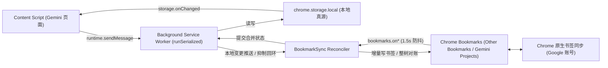

# 浏览器书签云同步设计文档（Chrome Bookmark Sync）

## 1. 背景与目标

本扩展当前所有数据均保存在 `chrome.storage.local`，仅支持同浏览器多标签页同步以及手动 JSON 备份/恢复。

在 **仅考虑 Chrome 且已登录 Google 账号** 的前提下，本设计利用 Chrome 原生 `chrome.bookmarks` API 与浏览器自带的书签同步能力，为 **Projects 与已归类聊天** 提供零后端、免配置、自动化的跨设备云同步。

### 设计目标
- **零基础设施 / 零鉴权**：复用 Chrome 已登录 Google 账号的书签同步通道，无需后端服务器，无需配置 Google Cloud OAuth。
- **突破 `storage.sync` 配额与 ID 限制**：不受 `chrome.storage.sync` 的 100 KB / 单 Key 8 KB 限制，也不要求多台设备具备相同的 Extension ID（个人多机 `Load unpacked` 也能直接同步）。
- **双向实时同步**：扩展内操作自动反映到书签；另一台电脑同步过来的书签变化，或在书签管理器 / 手机 Chrome 里的调整，也能自动同步回 Gemini 侧边栏。
- **无感静默体验**：无需额外设置开关或侧边栏状态栏，保持原有 Local-First 交互延迟与离线可用性。

---

## 2. 同步范围与非目标

| 数据模块 | 存储 Key | 是否纳入书签同步 | 说明 |
| --- | --- | --- | --- |
| **Projects** | `gemini_projects_v1.projects` | **是** | 文件夹名、排序、以及图标/样式/配色/置顶元数据均同步 |
| **已归类 Chats** | `gemini_projects_v1.chatIndex`（`projectId != null`） | **是** | 以书签链接形式存在对应 Project 子文件夹下 |
| **未归类 Chats** | `gemini_projects_v1.chatIndex`（`projectId == null`） | **否** | 新设备侧边栏原生 DOM 扫描会自动发现，不写书签 |
| **UI 折叠偏好** | `gemini_projects_v1.uiPrefs` | **否** | 各设备侧边栏宽度与使用习惯独立，保持本地 |
| **Prompt Library** | `gp_prompts_store` | **否** | 提示词文本可能很长，不适合编码进书签 URL；保持本地 |
| **长回复折叠状态** | `gp_gemini_response_folds_v1` | **否** | 属于单机阅读偏好，保持本地 |

### 权限与 UI 约定
- 在 `public/manifest.json` 中直接声明 `"bookmarks"` 为必需权限，安装/升级后默认常开。
- 日常同步后台静默运行，不在侧边栏增加同步状态图标或开关；异常统一输出 `console.warn`。
- 保留现有 `Backup` / `Restore` JSON 备份入口，并将 `Restore` 与书签同步联动。

---

## 3. 书签树结构与数据规范

### 3.1 根目录定位
- 固定位置：**其他书签（Other Bookmarks）** 下的 **`Gemini Projects`** 文件夹（不占用顶部书签栏）。
- **动态定位“其他书签”**：通过 `chrome.bookmarks.getTree()` 查找 `folderType === 'other'` 的顶层子节点；若旧版 Chrome 未提供 `folderType`，回退取根节点的第二个子节点（通常 `id === '2'`），避免硬编码导致异常。

### 3.2 目录层级结构

```text
其他书签 (Other Bookmarks)
└── Gemini Projects/                      ← 扩展管理的固定根目录
    ├── 工作研究/                          ← 一级子文件夹，对应一个 Project（顺序 = sortIndex）
    │   ├── 架构评审讨论                   ← 聊天书签：https://gemini.google.com/app/<conversationId>
    │   └── SQL 性能优化                   ← 多账号链接：https://gemini.google.com/u/1/app/<conversationId>
    ├── 写作灵感/
    │   └── 专栏大纲
    └── _Gemini Projects Config           ← 集中配置书签（固定排在根目录末尾）
```

### 3.3 集中配置书签格式（`_Gemini Projects Config`）
- **标题常量**：`_Gemini Projects Config`
- **位置**：固定位于 `Gemini Projects` 根目录下的最后一个子节点，确保各 Project 子文件夹内部只有干净的聊天书签。
- **URL 格式**：
  ```text
  https://gemini.google.com/#gp-sync-v1=<url-safe-base64-encoded-utf8-json>
  ```
  使用标准 `https://gemini.google.com/` 前缀，即使用户在书签管理器误点该条目，也只会打开 Gemini 首页而不会报错。
- **紧凑 Payload Schema**：
  ```ts
  interface BookmarkConfigPayloadV1 {
    v: 1;
    p: Array<{
      id: string;                 // Project.id
      n: string;                  // Project.name（与子文件夹标题对应）
      i: ProjectIcon;             // Project.icon
      s: ProjectIconStyle;        // Project.iconStyle ('outline' | 'solid' | 'duotone')
      c?: string;                 // Project.color（可选 hex）
      u?: 1;                      // Project.useIconPalette === true 时为 1
      pin?: 1;                    // Project.isPinned === true 时为 1
      at: number;                 // Project.updatedAt（用于多配置书签 LWW 合并）
      ct?: number;                // Project.createdAt
      cids?: string[];            // 最近关联的部分 conversationId 列表（可选，用于辅助识别手动改名）
    }>;
  }
  ```
  - 单项目约 80–130 字节（不含大量 `cids` 时；`cids` 可只存前 N 个或全量短 ID 视体积动态裁剪，保证整条配置 URL 远低于安全阈值，例如 `< 16 KB`）。
  - 所有解析出的字段必须复用 `src/shared/storage.ts` 的校验函数（`isSafeId`、`isProjectColor`、`isProjectIconStyle`）清洗，防止篡改或损坏数据污染本地状态。

### 3.4 排序与置顶映射
- **`sortIndex`**：直接对应 `Gemini Projects` 根目录下各 Project 子文件夹的排列顺序（`0, 1, 2, ...`）。
  - 在书签管理器里拖拽重排子文件夹 → 同步更新各项目的 `sortIndex`。
  - 写入书签时按 `sortIndex` 升序排列子文件夹，配置书签固定排末尾。
- **`isPinned`**：仅保存在 `_Gemini Projects Config` 的 `pin` 字段中，**不挪动书签子文件夹顺序**。
  - 完整保留现有特性：侧边栏中置顶项目排最前，取消置顶后自动恢复回原 `sortIndex` 位置。

### 3.5 聊天书签 URL 与标题规范
- **URL**：保留原生扫描并经 `normalizeChatUrl()` 校验的完整 URL（含多 Google 账号路径如 `https://gemini.google.com/u/1/app/<conversationId>`）；若缺失 `lastUrl`，回退生成 `https://gemini.google.com/app/<conversationId>`。
- **唯一标识**：只认从 URL 提取并经 `isSafeId` 校验的 `conversationId`，**绝不依赖设备本地自增的 `bookmark.id`**。
- **标题同步优先级**：
  - 已归类聊天在 Gemini 原生侧边栏重命名时，`upsertChatRefs` 经防抖（`1500ms`）同步更新对应书签标题。
  - 若用户在书签管理器中手动修改了聊天书签标题，对账时会临时更新本地 `chatIndex.title`；但下一次 Gemini 原生侧边栏扫描到该对话时，仍以 **Gemini 原生标题为准**。

---

## 4. 架构设计与同步流程

### 4.1 总体架构（Local-First + Single-Writer）



- **`chrome.storage.local` 依然是唯一本地真源**：UI 读取与渲染路径零改动，离线时扩展照常工作，联网后由 Chrome 自动完成书签同步。
- **全部书签读写收敛到 Background 的 `runSerialized` 串行队列**：避免多标签页与书签事件并发修改导致状态竞态。

### 4.2 扩展 → 书签（Push）

| Background Action | 书签同步策略 |
| --- | --- |
| `upsertProject` | 立即（或微合并）增量同步对应子文件夹名称、顺序及配置书签 |
| `setProjectPinned` | 仅更新 `_Gemini Projects Config` 中的 `pin` 与 `at`，不移动文件夹 |
| `deleteProject` | 删除对应 Project 子文件夹（及其中的聊天书签，非目标节点处理见 5.5）并更新配置书签 |
| `moveChat` | 移入 Project：在目标子文件夹创建/移动聊天书签；移出（`projectId = null`）：删除对应聊天书签 |
| `upsertChatRefs` | 仅当涉及 `projectId != null` 的聊天且标题/URL 实际变化时，经 **1500ms 防抖**更新对应书签 |
| `restoreBackup` | 校验并写入本地后，立即以恢复后的 `StoredState` **全量覆盖同步**到 `Gemini Projects` 书签目录 |

**回环抑制（Echo Suppression）**：
- Background 执行书签写入前递增/置位 `internalWriteDepth`（或在写入结束后的短冷却窗口内记录自身修改），写入期间触发的 `chrome.bookmarks.on*` 事件直接忽略，杜绝 `写书签 -> 触发事件 -> 写本地 -> 再写书签` 的死循环。

### 4.3 书签 → 扩展（Pull / Reconcile）
- 监听 `chrome.bookmarks` 的 `onCreated`、`onChanged`、`onMoved`、`onRemoved`、`onImportBegan`、`onImportEnded`。
  - 当收到 `onImportBegan` 时暂停对账，等待 `onImportEnded` 后统一执行一次。
  - 普通事件先做快速过滤（尽量判断与 `Gemini Projects` 相关，删除/移动等无法仅凭参数判定的则放行），统一进入 **1500ms 防抖定时器**。
- 防抖触发后进入 `runSerialized` 队列，执行**整树扫描与对账（Reconcile）**：
  1. 定位并归一化根目录与配置书签（含多根目录/多配置书签合并，见 5.2）。
  2. 解析书签树中的一级 Project 子文件夹与合法聊天书签。
  3. 与当前本地 `StoredState` 对比合并，若有变化则提交到 `chrome.storage.local`（各打开的 Gemini 标签页随即通过现有 `storage.onChanged` 自动刷新）。
  4. 若对账过程中触发了去重、改名继承或配置自愈，顺带把规范化后的结果回写到书签（处于回环抑制保护内）。

---

## 5. 关键算法与边界策略

### 5.1 首次冷启动（Bootstrap）并集合并
本地 `chrome.storage.local` 额外保存一个轻量状态键 `gp_bookmark_sync_meta_v1`：
```ts
interface BookmarkSyncMeta {
  initialized: boolean;
  lastRootBookmarkId?: string;
}
```
扩展 Service Worker 启动或首次 `getState` 时执行 `ensureInitialized()`：
1. **本地无项目、书签有内容（新设备）**：直接从书签导入到本地，标记 `initialized = true`。
2. **本地有项目、书签无目录或为空（老设备首升）**：创建 `Gemini Projects` 根目录并将本地项目与已归类聊天推送到书签，标记 `initialized = true`。
3. **本地有项目、书签也有内容（两台老设备先后升级）**：执行**首次并集合并**：
   - 两边各自独有的 Project 全部保留（同名项目合并样式，取 `updatedAt` 较新者）。
   - 两边各自独有的已归类 `conversationId` 全部保留。
   - 若同一个 `conversationId` 在本地和书签属于不同 Project，优先以**书签侧**（或 `updatedAt` 较新者）为准。
   - 合并结果双向写回 `chrome.storage.local` 与书签，并标记 `initialized = true`。
4. 后续常规运行（`initialized === true`）：严格按双向实时同步规则执行。

### 5.2 双端并发冲突自动清理
1. **多个同名 `Gemini Projects` 根目录**：
   - 在“其他书签”下扫描全部标题为 `Gemini Projects` 的文件夹（无 `url`）。
   - 保留 `dateAdded` 最早的那个作为主根目录；将其余根目录下的子文件夹和配置书签并入主根目录后，仅删除已为空的多余根目录（若内含用户非目标书签则不强行误删）。
2. **多条 `_Gemini Projects Config` 配置书签**：
   - 解析所有匹配的配置书签，按项目（先按 `id`、再按规范化名称）逐项比较 `at`（`updatedAt`），取最新者（LWW）合成唯一一份配置写回主配置书签，删除多余的配置书签。
3. **同名 Project 子文件夹**：
   - 规范化比较 `name.trim()`（可不区分大小写，与弹窗重名校验一致）。
   - 若发现多个同名子文件夹，把后者的合法聊天书签迁移到保留的文件夹中，若旧文件夹迁移后为空则删除。
4. **重复聊天书签（同一 `conversationId` 出现在多个子文件夹）**：
   - 保留 `dateAdded` 较新（若相同则按扫描靠后者）的文件夹归属，自动删除旧文件夹中重复的该聊天书签，保证 `conversationId -> projectId` 的 1 对 1 不变量。

### 5.3 配置书签与子文件夹绑定（含手动改名识别）
将扫描到的书签子文件夹列表与配置项匹配时，按以下三级优先级执行：
1. **一级（精确名称匹配）**：子文件夹 `title.trim()` 与配置项 `n.trim()` 一致 → 直接复用配置项的 `id` 与样式。
2. **二级（聊天 ID 重合度识别手动改名）**：对未匹配上的子文件夹与未匹配上的配置项，计算子文件夹内 `conversationId` 集合与配置项记录的 `cids`（以及当前本地 `chatIndex` 中属于该配置项 `id` 的聊天集合）的交集大小；按交集最大且非空贪心配对 → 视为用户在书签管理器手动重命名了该项目，继承原 `id` 与样式，并更新配置里的 `n`。
3. **三级（兜底新建）**：仍未匹配的子文件夹（例如用户在书签管理器里新建了空项目文件夹），生成新 `id`（`crypto.randomUUID()`）并赋予默认图标与样式（`icon: 'default'`、`iconStyle: DEFAULT_PROJECT_ICON_STYLE`、`useIconPalette: true`），随后补写入配置书签。

### 5.4 删除语义与误删自愈
- **删除单个 Project 子文件夹**：同步删除本地对应 `Project`，并将其下所有聊天的 `chatIndex[cid].projectId` 置为 `null`（不会删除 Gemini 原生聊天，聊天会重新出现在原生侧边栏）。
- **删除单条聊天书签**：同步将本地 `chatIndex[cid].projectId` 置为 `null`（同样不删原始聊天）。
- **根目录 `Gemini Projects` 整体被误删**：
  - 当 `initialized === true` 且扫描发现“其他书签”下已完全找不到 `Gemini Projects` 目录，而本地 `state.projects.length > 0` 时，**判定为根目录误删**。
  - **保护本地数据不被清空**，自动用当前本地 `StoredState` 重建 `Gemini Projects` 目录及全部子项。
- **配置书签 `_Gemini Projects Config` 被误删**：
  - 对账时若配置书签不存在，但本地 `state.projects` 中已有同名（或按聊天 ID 匹配的）Project，直接沿用本地缓存的 `id` 与样式并自动重建配置书签。
  - 若是全新设备且无本地缓存，则按三级兜底用默认样式生成并重建配置书签。

### 5.5 非目标节点保护原则（只管自己的节点）
- 只解析和修改：
  1. `Gemini Projects` 下的一级子文件夹；
  2. 一级子文件夹中 URL 满足 `normalizeChatUrl()` 的合法 Gemini 聊天书签；
  3. 根目录下的 `_Gemini Projects Config` 配置书签。
- **绝不删除、绝不移动**：
  - 用户放入的任意非 Gemini 链接（如普通参考网页）；
  - 二层及以上的嵌套子文件夹。
- 由此衍生的 `deleteProject` 细节：在扩展内删除某 Project 时，先删除该子文件夹内所有合法 Gemini 聊天书签；**仅当该子文件夹已彻底为空时才调用 `bookmarks.removeTree` / `remove`**，如果里面留有用户的其他网页书签或嵌套子目录，则保留这些用户内容（或仅移除空壳）。

### 5.6 扩展内重名 Project 校验
- 统一规范化比较规则：`normalizeProjectNameKey(name) = name.trim().toLowerCase()`。
- **前端校验（`src/content/ui/projectsPanel.ts`）**：新建或编辑保存前检查是否与其他 Project（排除当前正在编辑的自身 `id`）重名；若重名则在弹窗内显示明确错误提示（如 `A project with this name already exists.`）并阻止提交。
- **后端兜底校验（`src/background.ts`）**：`upsertProject` 同样做重名检查，防止多标签页并发提交同名项目。

---

## 6. 代码改造清单

| 文件 | 变更类型 | 主要职责 |
| --- | --- | --- |
| `public/manifest.json` | 修改 | 在 `permissions` 中添加 `"bookmarks"` |
| `src/shared/webext.ts` | 修改 | 封装 `chrome.bookmarks` 常用方法（`getTree`、`getSubTree`、`create`、`update`、`move`、`remove`、`removeTree`）的 Promise 兼容包装 |
| `src/shared/storage.ts` | 修改 | 导出/补充 `normalizeProjectNameKey` 等复用校验工具 |
| `src/background/bookmarkSync.ts` | **新增** | 核心同步模块：根目录定位与多根合并、配置书签编解码与 LWW 合并、冷启动并集合并、双向对账（Reconciler）、防抖与回环抑制、事件监听注册 |
| `src/background.ts` | 修改 | 接入 `bookmarkSync` 初始化；在 `upsertProject` 加入重名校验；在各状态变更与 `restoreBackup` 后触发对应书签推送；为 `bookmarkSync` 提供经 `runSerialized` 串行提交本地状态的回调 |
| `src/content/ui/projectsPanel.ts` | 修改 | 在新建/编辑 Project 弹窗增加重名校验与错误提示 |

---

## 7. 验证与测试清单

实现完成后需按以下核心场景逐项验证：

1. **冷启动场景**
   - 老设备升级（本地有数据、书签无目录）→ 自动生成 `Other Bookmarks / Gemini Projects`、子文件夹、聊天书签与 `_Gemini Projects Config`。
   - 新设备接入（本地为空、书签已有同步数据）→ 自动还原所有项目、图标/配色/置顶、排序与聊天归属。
   - 双老设备升级（本地和书签同时有不同数据）→ 并集合并，两边数据均未丢失。
2. **扩展 → 书签推送**
   - 新建/重命名/编辑样式/置顶/取消置顶/删除 Project → 书签与配置书签同步更新，且取消置顶恢复原顺序。
   - 拖入/菜单移入/移出聊天 → 对应子文件夹增删书签；未归类聊天不写入书签。
   - 已有聊天在 Gemini 原生改名 → 防抖后书签标题更新。
   - 多账号 `/u/1/app/<id>` 链接 → 书签完整保留 `/u/1/`。
   - 重名校验 → 弹窗与后台均阻止创建/改成已存在项目名。
3. **书签 → 扩展反向同步**
   - 在书签管理器改子文件夹名 → 扩展识别为改名并保留原图标/颜色/置顶。
   - 在书签管理器拖拽调整子文件夹顺序 → 扩展侧边栏排序同步变化。
   - 在书签管理器把聊天书签拖到另一个 Project 文件夹 → 扩展中聊天归属同步切换。
   - 在书签管理器删除子文件夹或单条聊天书签 → 扩展同步删除项目或取消归属（聊天回到原生侧边栏）。
4. **并发与防误删容错**
   - 手动模拟两个 `Gemini Projects` 根目录 / 两条 `_Gemini Projects Config` / 两个同名子文件夹 / 同一聊天出现在两个文件夹 → 自动合并去重且无死循环。
   - 手动删除整个 `Gemini Projects` 根目录 → 本地 Projects 不被清空，根目录自动重建。
   - 手动删除 `_Gemini Projects Config` → 保留本地样式并自动补建配置书签。
   - 在 Project 文件夹里放入普通网页书签与嵌套子文件夹 → 同步与删除操作均不破坏这些用户书签。
5. **Backup / Restore 联动**
   - 导入 JSON 备份 → 本地状态与书签目录同步恢复为备份内容。
